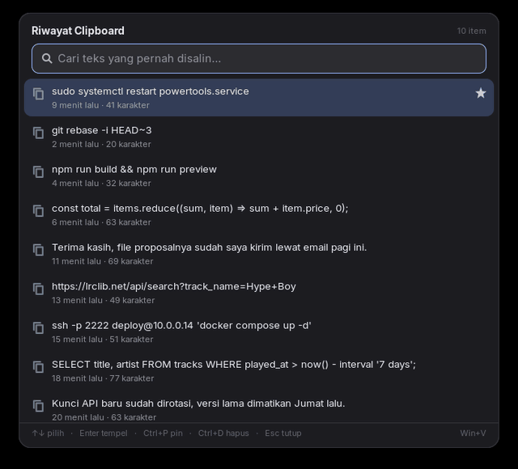
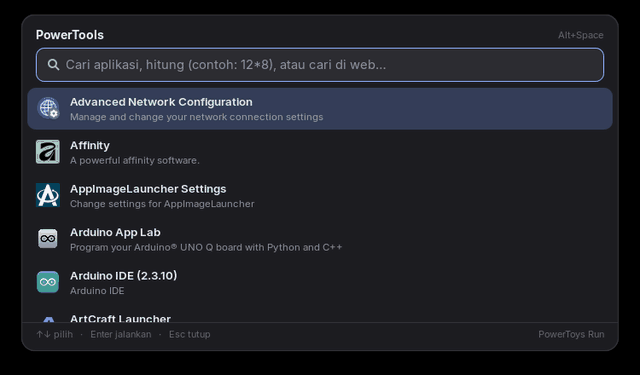
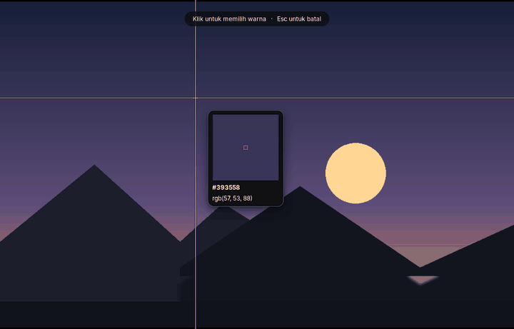
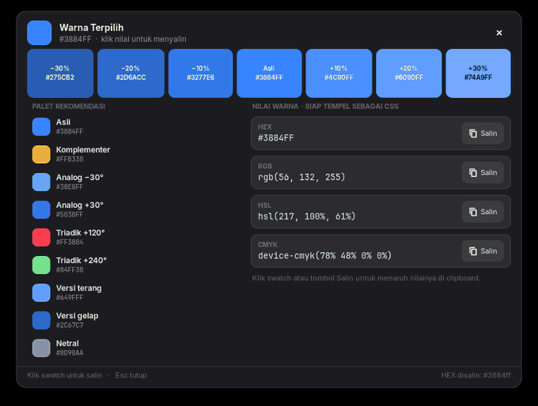
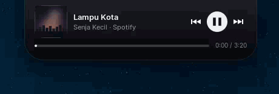
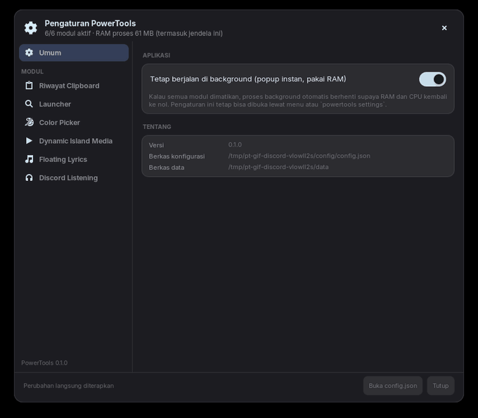
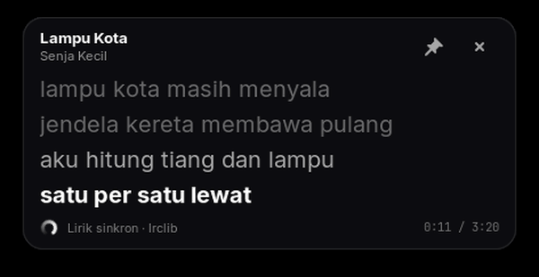
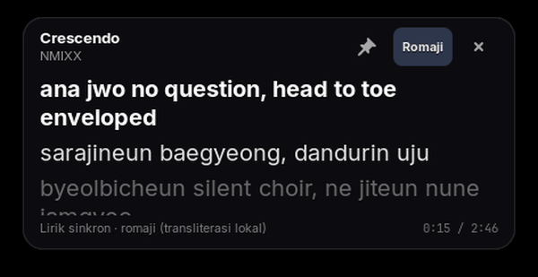
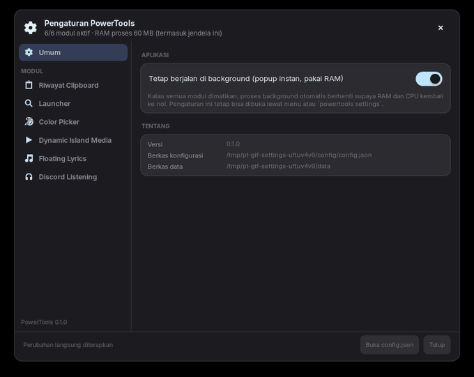

# PowerTools untuk Linux

<a href="https://sociabuzz.com/coveedboy/tribe"></a>

Pengganti ringan untuk tiga fitur Windows 11 / PowerToys yang paling sering
dirindukan saat pindah ke Linux, plus **lirik mengambang** yang belum ada di
Windows:

| Fitur Windows | Di PowerTools |
| --- | --- |
| Clipboard history (`Win+V`) | `Super+V` |
| PowerToys Run (`Alt+Space`) | `Alt+Space` |
| Color Picker (`Win+Shift+C`) | `Super+Shift+C` |
| — | Lirik mengambang: `Super+Shift+L` |
| — | Listening to Discord (opsional, lihat di bawah) |

Dibuat untuk **Zorin OS 18.1 / GNOME 46 / Wayland**, tapi juga jalan di distro
GNOME lain (Ubuntu, Fedora, Arch) dan punya fallback untuk sesi X11.





---

## Fitur

### Riwayat clipboard (`Super+V`)
- **Otomatis** merekam semua teks yang Anda salin — tanpa perlu membuka aplikasi.
- **Menangkap gambar** juga: screenshot (`PrtSc`), "Copy image" di browser,
  atau gambar dari aplikasi apa pun (PNG, JPEG, WebP, BMP) ikut tersimpan
  sebagai thumbnail dan bisa ditempel kembali. Format asli dipertahankan
  (tanpa konversi), jadi kualitasnya utuh dan penyalinan tetap instan.
- Muncul persis di tengah layar seperti Win+V, langsung bisa diketik untuk mencari.
- **Klik atau `Enter` langsung menempel** item ke aplikasi/jendela yang aktif
  sebelum popup dibuka — tidak perlu `Ctrl+V` lagi. Item tetap tersimpan di
  clipboard, jadi `Ctrl+V` manual berikutnya menempelkan item yang sama.
- Clipboard diisi oleh **ekstensi**, bukan proses Python: di Wayland Mutter
  hanya menerima permintaan clipboard dari klien yang sedang memegang fokus
  keyboard, sedangkan popup kehilangan fokus tepat saat ditutup. Karena shell
  sendiri pemilik selection, yang ditempel selalu item yang dipilih — bukan
  item copy terakhir.
- `Ctrl+P` pin (item yang di-pin tidak pernah terhapus dan bebas dari masa
  kedaluwarsa), `Ctrl+D` hapus, `Esc` tutup.
- Riwayat bisa dibatasi otomatis lewat `clipboard.max_age_minutes` dan
  `clipboard.max_items` (lihat [Konfigurasi](#konfigurasi)).
- Duplikat otomatis digabung: menyalin teks/gambar yang sama tidak membuat entri
  baru, hanya menaikkannya ke atas.
- Riwayat tetap terkumpul walau aplikasi sedang tidak berjalan (yang mencatat
  adalah ekstensi GNOME, bukan proses Python).

### Launcher (`Alt+Space`)
- Mencari aplikasi `.desktop` dengan fuzzy match + skor frekuensi/kebaruan
  (aplikasi yang sering dipakai naik ke atas).
- Kalkulator aman tanpa `eval`: `12*8`, `sqrt(2)`, `pi*2`, `50% of 240`,
  `15% dari 200`. `Enter` menyalin hasilnya.
- Pintasan cepat: `Riwayat Clipboard`, `Ambil Warna`, `Lirik Mengambang`,
  `Pengaturan`.
- Kalau tidak ada yang cocok: tawaran cari di web (Google).
- Tinggi jendela menyesuaikan jumlah hasil (tidak ada ruang kosong).

### Color picker (`Super+Shift+C`)
1. Memakai **color picker bawaan GNOME Shell** (ada loupe + magnifier, paling mulus).
2. Kalau tidak tersedia: portal `org.freedesktop.portal.Screenshot.PickColor`.
3. Kalau portal juga tidak ada: overlay screenshot sendiri dengan crosshair,
   magnifier 8×, dan kartu `#RRGGBB` + `rgb()`.





Setelah warna diambil, **jendela hasil mengambang** muncul di atas dengan:
- **Hex, RGB, HSL, dan CMYK** dalam sintaks CSS, masing-masing punya tombol
  **Salin**. CMYK memakai `device-cmyk()` (CSS Color 5).
- Deret **10–30% lebih gelap/terang** di bagian atas. Klik salah satu swatch
  untuk menyalin hex-nya.
- **Palet rekomendasi** di kolom kiri: komplementer, analog, triadik, versi
  terang/gelap, dan netral. Klik untuk menyalin.
- Format default (`color.format`) tetap otomatis disalin saat warna diambil,
  jadi alur cepat "ambil lalu `Ctrl+V`" tetap jalan.
- `Esc` atau tombol silang menutup jendela.

Warna juga disalin ke clipboard dengan format default yang bisa diatur:
`hex`, `rgb`, `hsl`, atau `cmyk`.

### Dynamic island media (MPRIS)

Widget gaya *Dynamic Island* di tepi atas layar untuk **semua pemutar media
yang mendukung MPRIS** — Spotify, VLC, mpv, Firefox/Chromium (YouTube, YouTube
Music), dan aplikasi lain. Tidak perlu plugin per aplikasi.

Isinya: cover album, judul + artis, tombol **⏮ ⏯ ⏭**, progress bar yang bisa
diklik/digeser, dan **chip pemilih pemutar** kalau ada lebih dari satu sumber
(tiap pemutar bisa dipilih sendiri).

Kemunculannya:

- **Media berubah** (lagu baru, pemutar mulai memutar, atau pemutar baru
  muncul) → widget muncul **5 detik** lalu menutup sendiri. Bisa diatur.
- **Pointer berhenti 1 detik di tengah tepi atas** → widget muncul selama
  pointer berada di sekitar widget. Hanya muncul kalau ada media yang sedang
  diputar. Kalau panel GNOME ada di atas, seluruh tinggi panel (termasuk jam)
  ikut dihitung; kalau panel dipindah ke bawah atau disembunyikan (mis. Zorin),
  area 36 px di tepi atas layar yang dipakai. Posisi pointer dicek berkala
  (10×/detik), jadi tetap terdeteksi walau pointer sudah diam di sana.
- Kalau pointer masuk ke widget, hitungan 5 detik ditahan; widget baru
  menutup setelah pointer keluar (dengan jeda singkat).
- Widget **menempel ke atas seperti tetesan air**: kalau panel ada di atas,
  sisi atasnya datar menyatu dengan bawah panel; kalau panel tidak di atas,
  ia menempel langsung ke tepi atas layar. Sisi bawah bulat. Saat muncul ia
  tumbuh ke bawah. Saat ada jendela fullscreen ia tetap muncul di atasnya.

Album art dari `file://`, `data:`, atau `http(s)://` didukung. Art jaringan
di-cache di `~/.cache/powertools/media-art` (dibersihkan otomatis setelah 30
hari), jadi lagu yang sama tidak mengunduh ulang.



### Listening to Discord (opsional)

Status **Listening to** di profil Discord menampilkan lagu yang sedang diputar:
judul, artis, cover album, dan progress bar yang berjalan sendiri. Sumbernya
MPRIS yang sama dengan dynamic island dan lirik, jadi berlaku untuk Spotify,
VLC, mpv, browser, dan pemutar lain.

Fitur ini **mati secara default**. Setelah dinyalakan, PowerTools memakai
Application ID bawaan supaya langsung bekerja tanpa langkah tambahan:

**Pengaturan** → **Discord Listening** → nyalakan saklar modul. Status
"Listening to ..." langsung muncul memakai preset **PowerTools (umum)**.

Application ID **tidak perlu diketik**. Semua ID sudah paten dan disediakan
PowerTools; yang diatur hanya **sumber mana yang memakai judul mana**.

#### Memilih sumber untuk tiap judul

1. Buka **Pengaturan** → **Discord Listening**.
2. Daftar menampilkan sumber yang sedang terbuka (Spotify, Brave, VLC, …)
   sekaligus sumber yang sudah pernah disimpan. Tekan **Muat ulang daftar
   aplikasi** kalau baru membuka pemutar musik.
3. Pada baris sumber, pilih preset lewat dropdown: **Otomatis**,
   **PowerTools (umum)**, atau **YouTube Music**.
4. Untuk sumber yang belum ada di daftar, pilih dari dropdown aplikasi di
   bawah daftar, pilih preset, lalu tekan **Tambah**.
5. Baris **Sumber lain** menentukan cadangan untuk sumber yang tidak dipilih
   sendiri: **Otomatis (bawaan)** memakai preset default, **Tidak dikirim**
   menyembunyikan status untuk sumber tersebut, atau pilih preset tertentu.



Pilihan disimpan sebagai `discord.app_ids` (sumber → Application ID preset) di
`config.json`, jadi tetap berlaku setelah PowerTools atau sesi desktop dimulai
ulang. **Otomatis** pada baris sumber menghapus pemetaan sumber itu dan
mengembalikannya ke baris **Sumber lain**. Tombol **Hapus** melakukan hal yang
sama.

Kalau sebelumnya Anda mengisi `discord.app_id` sendiri, nilai itu tetap
dihormati sebagai cadangan dan muncul sebagai baris **Application ID lama**
dengan tombol **Hapus**. Setelah dihapus, semua sumber memakai preset.

Tidak perlu bot, token, atau login. PowerTools hanya berbicara dengan Discord
desktop lewat socket lokal (`discord-ipc-*`), termasuk versi Flatpak/Snap;
Discord sendirilah yang menyinkronkan status ke profil. Status otomatis hilang
saat lagu berhenti, modul dimatikan, atau Discord ditutup.
`discord.show_paused` menampilkan status saat lagu dijeda, dan
`discord.show_album_art` mengirim cover album `http(s)`.

Discord harus berjalan dan PowerTools harus tetap di background
(`resident: true`, default) agar status terus diperbarui.

#### Judul "Listening to ..." mengikuti nama aplikasi

Discord selalu menulis **"Listening to <nama aplikasi>"**, dan nama itu diambil
dari Developer Portal — bukan dari nama pemutar yang terdeteksi. Nama aplikasi
tidak bisa diubah saat runtime, jadi **satu nama tambahan berarti satu
aplikasi Discord tambahan**.

PowerTools menyertakan dua preset bawaan:

| Kunci preset | Judul "Listening to ..." | Dipakai untuk |
| --- | --- | --- |
| `default` | `PowerTools` | sumber yang tidak dipetakan |
| `youtube-music` | `YouTube Music - PowerTools` | YouTube Music |

Menambah platform baru (mis. Spotify, VLC) cukup menambah satu entri di
`APP_PRESETS` (`powertools/sources.py`). GUI dan service otomatis
menampilkannya di dropdown, jadi tidak ada perubahan lain yang diperlukan.

Kalau ingin memakai aplikasi Discord milik Anda sendiri, isi ID-nya lewat
`discord.app_id` atau `discord.app_ids.<sumber>` di config. GUI hanya
menawarkan preset; ID bebas tidak bisa diketik dari jendela Pengaturan.

```bash
powertools config set discord.app_id 123456789012345678
powertools config set discord.app_ids.spotify 123456789012345678
```

Kunci sumber yang dikenali adalah nama sumber yang tampil di
`powertools doctor` (baris **Sumber terdeteksi**), mis. `spotify`, `vlc`,
`mpv`, `brave`, `youtube-music`, `youtube`, `soundcloud`, `tidal`, `deezer`,
`netflix`, `twitch`.

Urutan pemilihan Application ID, dari yang paling spesifik:

1. `discord.app_ids.<sumber>` — preset yang dipilih di Pengaturan
2. preset untuk sumber itu (kalau saklar preset aktif)
3. `discord.app_ids.default` — cadangan eksplisit
4. `discord.app_id` — ID lama milik Anda
5. preset `default` (kalau saklar preset aktif)

Preset per sumber sengaja berada di atas `discord.app_id` supaya YouTube Music
tetap mendapat namanya sendiri meskipun Anda sudah mengisi ID lama.
`discord.use_builtin_ids: false` mematikan seluruh preset; setelah itu hanya
`app_ids` dan `app_id` milik Anda yang dipakai, dan sumber yang tidak dipetakan
tidak dikirim ke Discord.

> **Penting:** Discord Developer Policy pasal 12 melarang impersonasi aplikasi
> lain ("Do not impersonate other Applications ... or Discord services"). Jadi
> **jangan** menamai aplikasi Discord persis `Spotify`, `YouTube Music`, atau
> `Netflix`. Beri label tidak resmi, misalnya `Spotify (unofficial)` atau
> `PowerTools — Spotify` seperti aplikasi bawaan `YouTube Music - PowerTools`.

Tentang ikon: aplikasi bawaan `YouTube Music - PowerTools` memakai ikon YouTube
Music **apa adanya, tanpa modifikasi** (Google melarang logo produknya diubah).
Google tetap mewajibkan izin lewat Partner Marketing Hub untuk ikon produknya,
dan meminta merek Anda lebih menonjol daripada ikon mereka — syarat yang tidak
sepenuhnya terpenuhi di kartu Discord. Untuk pemakaian pribadi ini tidak
dipersoalkan; kalau Anda menyebarkan PowerTools luas, buat aplikasi Discord
sendiri dengan ikon Anda lalu petakan lewat `discord.app_ids.<sumber>`.

Browser hanya melaporkan dirinya sendiri (`brave`, `firefox`, …), bukan situs
yang sedang diputar. PowerTools menebak situs dari judul/album — berhasil untuk
YouTube ("… - YouTube") dan SoundCloud, tetapi **YouTube Music di browser
biasanya hanya memberi judul lagu**, sehingga terdeteksi sebagai `brave`. Kalau
Anda selalu memakai satu layanan di browser, pilih baris **Brave** (atau browser
lain) di Pengaturan lalu ganti presetnya ke **YouTube Music**. Spotify desktop,
VLC, dan mpv selalu terdeteksi tepat.

#### Cover album

Discord hanya bisa mengambil gambar dari internet. Cover dari Spotify, VLC, dan
mpv biasanya `http(s)` sehingga langsung tampil. Browser (YouTube Music,
SoundCloud) melaporkan cover sebagai file sementara `file:///tmp/...` yang tidak
bisa diakses Discord, sehingga muncul tanda **"?"**.

Solusinya unggah satu gambar di Developer Portal → **Rich Presence** →
**Art Assets** (mis. nama asset `music`), lalu isi:

```bash
powertools config set discord.fallback_asset music
```

Asset itu dipakai setiap kali cover hanya tersedia sebagai file lokal.
`discord.show_album_art: false` mematikan gambar sama sekali (tidak ada "?").
Kalau nama asset salah, status di Pengaturan berubah menjadi
*"asset \"…\" tidak ada di portal Discord"* — Discord memang membuang asset
yang tidak dikenal tanpa pesan error.

Asset hanya bisa diunggah ke aplikasi Discord **milik Anda**, jadi fitur ini
butuh `discord.use_builtin_ids: false` dan Application ID sendiri lewat
`discord.app_id` / `discord.app_ids.<sumber>`. Dengan preset bawaan,
`fallback_asset` tidak berguna karena Anda tidak bisa mengunggah asset ke
aplikasi milik PowerTools.

Tanda **"?"** juga muncul kalau aplikasi Discord Anda belum punya ikon:
unggah ikon di Developer Portal → **General Information** → **App Icon**.
Ikon itu yang dipakai Discord saat activity tidak membawa gambar.

### Lirik mengambang (`Super+Shift+L`)

Jendela lirik kecil yang mengambang di kanan bawah layar dan **menggulir
sendiri mengikuti posisi lagu**. Sumber liriknya [LRCLIB](https://lrclib.net) —
gratis, tanpa API key, dan menyediakan lirik sinkron (LRC) untuk ribuan lagu.



- Lagu dibaca dari **MPRIS**, jadi berlaku untuk Spotify, VLC, mpv, Firefox,
  Chromium (YouTube/YouTube Music), dan pemutar lain — sama seperti island.
- Baris yang sedang dinyanyikan **disorot tebal**, baris tetangganya sedikit
  lebih terang, sisanya redup. Scroll dianimasikan halus, bukan lompat.
- Kalau lirik tidak punya timestamp, teks tetap ditampilkan (tanpa sorotan).
- **Gulir manual** dengan roda mouse/dua jari: auto-scroll berhenti 6 detik
  supaya Anda bisa membaca bagian lain, lalu kembali mengikuti lagu.
- **Klik dua kali pada baris lirik** untuk melompat ke bagian itu: PowerTools
  meminta pemutar MPRIS melakukan `SetPosition` (atau `Seek` relatif kalau
  pemutar tidak memberi track id). Baris yang diklik langsung jadi baris aktif,
  dan offset `lyrics.offset_ms` ikut diperhitungkan. Kalau pemutar tidak
  mendukung seek (`CanSeek: false`), status bar menampilkan pesan singkat.
- Tombol **pin** menyematkan jendela di atas semua jendela lain; lepas pin
  untuk kembali menjadi jendela biasa yang bisa tertutup. Status pin disimpan
  di `lyrics.pinned`, jadi tetap berlaku saat dibuka lagi.
- Offset waktu bisa digeser (`lyrics.offset_ms`) kalau lirik terasa terlalu
  cepat/lambat, dan ukuran teks diatur lewat `lyrics.font_size`.
- **Kepekatan latar** diatur lewat `lyrics.opacity` (30–100%). Turunkan
  nilainya supaya jendela di belakang lirik ikut terlihat. Yang dibuat tembus
  pandang hanya latar kartunya; teks tetap pekat (dengan bayangan tipis) agar
  lirik masih terbaca di atas jendela terang.
- **Taskbar tetap bersih**: jendela lirik disembunyikan dari taskbar dan
  Alt-Tab (`lyrics.hide_from_taskbar`, default aktif). Ikon PowerTools di
  panel tetap bisa membukanya kapan saja; tanpa ekstensi GNOME, jendela
  tampil seperti biasa.
- **Romaji** untuk lagu Korea/Jepang: tombol `Romaji` di header (hanya muncul
  kalau versi Latin benar-benar tersedia) mengganti lirik ke huruf Latin tanpa
  mengubah sinkronisasi. Lihat [Romaji](#romaji-lagu-koreajepang).
- Lirik di-cache di `~/.cache/powertools/lyrics` (30 hari), termasuk hasil
  "tidak ditemukan" selama 6 jam supaya tidak menembak API berulang kali.
- `lyrics.auto_show` membuat jendela muncul sendiri setiap kali lagu mulai
  diputar (default mati).
- `lyrics.romanize` (default mati) menentukan tampilan awal romaji; tombol di
  jendela lirik menyimpan pilihan yang sama.

#### Romaji (lagu Korea/Jepang)

Tidak ada parameter romaji di API LRCLIB — yang tersimpan hanyalah apa yang
diunggah kontributor. Jadi versi Latin disiapkan di sisi klien lewat dua jalur:

1. **Unggahan LRCLIB.** Untuk lagu yang liriknya memakai aksara non-Latin,
   PowerTools mencari rekaman lain dari lagu yang sama yang isinya sudah huruf
   Latin. Kandidat hanya dipakai kalau durasinya sama (±2 detik), punya
   timestamp kalau lirik aslinya bertimestamp, dan proporsi vokalnya khas
   romaji — supaya terjemahan bahasa Inggris tidak ikut terpilih. Diuji pada
   beberapa lagu, jalur ini berhasil untuk sekitar seperempat lagu Jepang.
2. **Transliterasi Hangul lokal.** Kalau tidak ada unggahan romaji, Hangul
   diubah dengan Revised Romanization memakai tabel bawaan (tanpa dependensi,
   tanpa memori tambahan). Aturan asimilasi konsonan tidak diterapkan, jadi
   hasilnya transliterasi baca, bukan romanisasi sempurna.

Lagu Jepang yang berkanji **tidak** ditransliterasi kalau tidak ada unggahan
romaji: kanji butuh kamus (puluhan MB), dan hasil setengah jadi lebih
membingungkan daripada lirik aslinya. Liriknya dibiarkan apa adanya. Hal yang
sama berlaku untuk lagu Mandarin — pinyin juga butuh kamus, dan unggahan pinyin
di LRCLIB praktis tidak ada.

**Beralih bolak-balik.** Tombol `Romaji` bekerja dua arah dan langsung:
Hangul/kanji → Latin dan sebaliknya, tanpa memuat ulang lagu dan tanpa
mengganggu posisi baca. Kalau jumlah barisnya sama (selalu begitu untuk
transliterasi lokal), teks diganti di tempat — tidak ada widget yang dibangun
ulang. Kalau berbeda (unggahan romaji kadang punya baris ekstra), tampilan
dibangun ulang tetapi posisi gulir dikembalikan, dan gulir manual yang sedang
aktif tidak dibatalkan.



NMIXX — "Crescendo" di atas adalah contoh jalur transliterasi: lagunya murni
Hangul dan tidak ada unggahan romaji di LRCLIB, jadi versi Latinnya dibuat
PowerTools sendiri. Bagian berbahasa Inggris dibiarkan apa adanya; hanya
Hangul yang diubah.

Cache lirik versi lama (dibuat sebelum fitur romaji ada) tidak punya data
romaji; entri seperti itu otomatis diambil ulang sekali, jadi tidak perlu
menghapus `~/.cache/powertools/lyrics` secara manual.

---

## Kebutuhan

- Python 3.10+ dengan PyGObject dan GTK 4
- GNOME Shell 45–48 (untuk clipboard otomatis dan hotkey global)
- Zorin/Ubuntu: `sudo apt install python3-gi python3-gi-cairo gir1.2-gtk-4.0 libglib2.0-bin`
- Untuk dynamic island: aplikasi pemutar yang mengekspos MPRIS (hampir semua
  pemutar Linux dan browser modern). Tidak ada paket tambahan.
- Untuk lirik: koneksi internet saat pertama kali sebuah lagu dibuka (sesudah
  itu memakai cache). Tidak ada paket tambahan.
- Untuk **Listening to Discord**: aplikasi Discord desktop (biasa, Flatpak,
  atau Snap). Application ID sudah tersedia sebagai preset, jadi tidak ada
  langkah pendaftaran. Tidak ada paket tambahan.

Tidak ada dependensi Python tambahan dan tidak ada layanan cloud milik
PowerTools. Permintaan jaringan hanya terjadi saat mengambil lirik dari API
publik LRCLIB dan saat island mengunduh cover album dari URL yang diberikan
pemutar. Clipboard, launcher, dan color picker tetap 100% offline.

---

## Instalasi

```bash
git clone https://github.com/stefanusade/powertools.git
cd powertools
./install.sh
```

Installer berjalan **tanpa `sudo`** — semua dipasang di `~/.local/share` dan
`~/.config`. Kalau ada dependensi yang belum ada, installer berhenti dan
menampilkan perintah `apt install` yang perlu Anda jalankan sendiri.

Yang dilakukan installer:

1. Menyalin program ke `~/.local/share/powertools/app` + pembungkus
   `~/.local/share/powertools/bin/powertools`.
2. Memasang ikon dan entri menu (`~/.local/share/applications`).
3. Memasang ekstensi GNOME `powertools@local` dan mengompilasi schema-nya.
4. Melepas `Alt+Space` dari menu jendela GNOME supaya bisa dipakai launcher.
5. Mengaktifkan autostart berlapis (systemd + GNOME + D-Bus) supaya layanan
   selalu hidup tanpa perlu dijalankan manual.

**Setelah instalasi pertama, logout lalu login sekali** agar GNOME memuat
ekstensinya. Cek hasilnya:

```bash
~/.local/share/powertools/bin/powertools doctor
```

Pilihan installer:

```bash
./install.sh --no-autostart   # jangan jalankan saat login (hemat RAM, popup pertama ~0,3 detik)
./install.sh --no-extension   # tanpa ekstensi GNOME (khusus sesi X11)
```

### Memperbarui setelah mengubah kode

Perintah `powertools` dan layanan background selalu menjalankan salinan di
`~/.local/share/powertools/app`, **bukan** folder repo. Jadi setelah menarik
atau mengubah kode, jalankan installer lagi:

```bash
git pull
./install.sh
```

Installer menyalin ulang program dan me-restart layanan, sehingga fitur baru
langsung aktif tanpa logout. Kalau jendela Pengaturan masih terbuka dari proses
lama, tutup lalu buka lagi. Ekstensi GNOME yang ikut berubah baru dimuat
setelah logout/login sekali.

### Autostart (dijamin, tanpa langkah manual)

PowerTools sengaja dipasang dengan **empat lapisan** supaya tidak pernah perlu
dijalankan manual setiap login:

| Lapis | Berkas | Fungsi |
| --- | --- | --- |
| systemd user service | `~/.config/systemd/user/powertools.service` | Dijalankan saat sesi grafis aktif, `Restart=on-failure` (hidup lagi kalau crash). |
| Autostart GNOME | `~/.config/autostart/powertools.desktop` | Cadangan kalau systemd user tidak dipakai; otomatis tidak melakukan apa-apa bila systemd sudah menangani. |
| Aktivasi D-Bus | `~/.local/share/dbus-1/services/io.github.powertools.App.service` | Begitu ada pemanggilan `ActivateAction`, bus sendiri yang menyalakan layanan. |
| Ekstensi GNOME | `powertools@local` | 8 detik setelah shell dimuat, menyalakan layanan kalau belum hidup. |

Jadi setelah login, `Super+V` / `Alt+Space` langsung terbuka tanpa cold start.
Kalau layanan mati karena crash, systemd menyalakannya lagi dalam ~2 detik.
Satu-satunya cara mematikannya secara permanen adalah `./uninstall.sh` atau
`powertools config set resident false` (mode hemat RAM 0 MB, memang sengaja
mematikan layanan latar belakang).

Autostart langsung berlaku setelah `./install.sh` dijalankan — tidak perlu
logout. Logout/login **sekali** hanya diperlukan agar ekstensi GNOME (perekam
clipboard dan hotkey) ikut dimuat oleh shell.

Cek status keempat lapisan kapan saja:

```bash
~/.local/share/powertools/bin/powertools doctor
# Autostart        : systemd (enabled), GNOME, D-Bus
```

---

## Pemakaian

| Aksi | Cara |
| --- | --- |
| Riwayat clipboard | `Super+V` |
| Launcher | `Alt+Space` (atau klik ikon PowerTools di menu) |
| Color picker | `Super+Shift+C` |
| Lirik mengambang | `Super+Shift+L` |
| Pin/unpin jendela lirik | Klik ikon pin di kanan atas jendela lirik |
| Lompat ke bagian lirik | Klik dua kali pada baris lirik |
| Buka lirik dari panel | Klik ikon PowerTools di panel → **Buka Lirik** |
| Dynamic island media | Arahkan pointer ke tengah tepi atas layar 1 detik (saat ada media berputar) |
| Ganti pemutar di island | Klik chip nama pemutar |
| Geser posisi lagu | Klik atau tarik progress bar di island |
| Pilih item | `↑` / `↓` lalu `Enter` |
| Pin / lepas pin | `Ctrl+P` |
| Hapus item | `Ctrl+D` |
| Tutup popup | `Esc` atau klik di luar |

CLI:

```bash
powertools              # buka launcher
powertools clipboard    # buka riwayat clipboard
powertools color        # color picker
powertools lyrics       # buka lirik mengambang
powertools settings     # buka pengaturan (GUI)
powertools daemon       # jalankan di background tanpa window
powertools quit         # hentikan proses background
powertools bridge       # perbaiki jembatan ekstensi GNOME tanpa logout
powertools doctor       # diagnosa instalasi
powertools config show
powertools config get clipboard.max_items
powertools config set clipboard.max_items 500
```

`powertools` tanpa path hanya tersedia kalau `~/.local/share/powertools/bin`
ada di `PATH`. Installer selalu menulis path lengkap di entri menu dan ekstensi.

### Ikon panel (tray)

Ekstensi menaruh ikon PowerTools di panel (area status kanan), terpisah dari
ikon taskbar. Klik ikonnya untuk menu cepat:

- **Buka Lirik**, **Riwayat Clipboard**, **Launcher**, **Ambil Warna** —
  sama dengan hotkey masing-masing.
- **Pengaturan** — membuka jendela pengaturan tanpa perlu terminal.
- **Keluar PowerTools** — menghentikan proses background.

Ikon ini tetap ada walau jendela lirik disembunyikan dari taskbar
(`lyrics.hide_from_taskbar`), jadi tetap ada jalan masuk saat taskbar bersih.
Kalau ikon tidak muncul setelah memperbarui PowerTools, jalankan
`powertools bridge` lalu logout/login sekali — kode ekstensi baru hanya
dimuat saat shell mulai.

### Mengubah shortcut

Shortcut disimpan di schema ekstensi, bisa diubah kapan saja:

```bash
gsettings set org.gnome.shell.extensions.powertools toggle-clipboard "['<Super>v']"
gsettings set org.gnome.shell.extensions.powertools toggle-launcher "['<Alt>space']"
gsettings set org.gnome.shell.extensions.powertools pick-color "['<Super><Shift>c']"
gsettings set org.gnome.shell.extensions.powertools toggle-lyrics "['<Super><Shift>l']"
```

Perubahan langsung berlaku tanpa logout.

### Mengatur dynamic island

Semua pengaturan island ada di schema ekstensi (langsung berlaku, tanpa
logout):

```bash
# matikan/hidupkan seluruh fitur
gsettings set org.gnome.shell.extensions.powertools media-island-enabled true

# lama pointer harus berhenti di tepi atas (milidetik, 0 = langsung)
gsettings set org.gnome.shell.extensions.powertools media-island-hover-delay 1000

# lama popup setelah media berubah (milidetik)
gsettings set org.gnome.shell.extensions.powertools media-island-popup-time 5000
```

---

## Pengaturan (GUI)

`powertools settings` (atau **Pengaturan PowerTools** dari launcher / menu
aplikasi) membuka jendela pengaturan. Semua perubahan langsung ditulis ke
`config.json` dan langsung berlaku — tidak perlu edit JSON atau restart.

### Modul yang bisa dimatikan

| Modul | Saat dimatikan |
| --- | --- |
| **Riwayat Clipboard** | Pemantau selection di shell dilepas (tidak ada lagi transfer clipboard saat Anda menyalin), hotkey `Super+V` mati, pemangkasan riwayat berhenti. |
| **Launcher** | Hotkey `Alt+Space` mati, dan daftar aplikasi `.desktop` tidak dipindai saat start (hemat CPU/RAM saat login). |
| **Color Picker** | Hotkey `Super+Shift+C` mati dan color picker tidak disiapkan. |
| **Dynamic Island Media** | Island tidak dibuat sama sekali: tanpa polling hover, tanpa koneksi MPRIS, tanpa unduhan cover. |
| **Floating Lyrics** | Pemantau MPRIS berhenti, jendela lirik ditutup, dan hotkey `Super+Shift+L` mati. |
| **Discord Listening** | Koneksi IPC ke Discord ditutup dan status Listening to langsung dihapus. Pemantau MPRIS tetap hidup kalau lirik masih aktif. |

Yang dimatikan benar-benar berhenti bekerja, bukan sekadar disembunyikan.
Kalau **semua** modul dimatikan, proses background tidak lagi ditahan sehingga
RAM/CPU PowerTools kembali ke nol (proses keluar sendiri). Begitu satu modul
dinyalakan lagi, layanan otomatis hidup kembali saat dipakai. Pengaturan tetap
bisa dibuka lewat menu atau `powertools settings`.

Saklar modul juga bisa diubah dari terminal
(`powertools config set modules.media false`); aplikasi dan ekstensi membaca
ulang `config.json` sendiri, jadi hasilnya sama dengan mengubahnya di GUI.

Selain saklar modul, GUI juga mengatur: auto-paste, penyimpanan gambar, kuota
dan masa kedaluwarsa riwayat, jumlah hasil launcher, URL pencarian, format
warna, jeda hover & lama popup island, opsi lirik (tampil otomatis, pin,
sembunyikan dari taskbar, offset waktu, ukuran teks, kepekatan latar),
**pemetaan sumber → judul
Listening to (dropdown aplikasi aktif + preset Application ID) + asset
cadangan cover + status koneksi**, dan opsi
`resident`.

Jendela pengaturan memakai **tab vertikal di sisi kiri**: satu tab `Umum`
(opsi aplikasi dan info versi/berkas) dan satu tab per modul. Tab modul yang
dimatikan ditandai titik abu-abu di navigasi dan menampilkan pemberitahuan di
atas opsinya, jadi status tiap fitur terlihat tanpa membuka satu per satu.



Tombol **Buka config.json** tetap tersedia untuk opsi lanjutan yang belum ada
di GUI (mis. `clipboard.max_chars`). Mengubah berkas itu dari luar juga
langsung terbaca: aplikasi dan ekstensi sama-sama memantau `config.json`.

---

## Konfigurasi

Berkas: `~/.config/powertools/config.json` (dibuat otomatis saat pertama jalan).

```json
{
  "resident": true,
  "modules": {
    "clipboard": true,
    "launcher": true,
    "color": true,
    "media": true,
    "lyrics": true,
    "discord": false
  },
  "clipboard": {
    "max_items": 300,
    "max_age_minutes": 0,
    "auto_paste": true,
    "max_chars": 100000,
    "images": true,
    "max_image_mb": 20,
    "max_image_items": 60,
    "max_shown": 120,
    "poll_fallback": true,
    "poll_ms": 800
  },
  "launcher": {
    "max_results": 9,
    "web_search": "https://www.google.com/search?q={query}"
  },
  "color": {
    "format": "hex"
  },
  "lyrics": {
    "auto_show": false,
    "pinned": false,
    "romanize": false,
    "offset_ms": 0,
    "font_size": 15,
    "opacity": 94,
    "hide_from_taskbar": true
  },
  "discord": {
    "app_id": "",
    "app_ids": {},
    "fallback_asset": "",
    "show_paused": false,
    "show_album_art": true
  }
}
```

| Kunci | Arti |
| --- | --- |
| `modules.*` | Saklar modul `clipboard`, `launcher`, `color`, `media`, `lyrics`, `discord`. `false` = benar-benar berhenti bekerja (lihat [Pengaturan](#pengaturan-gui)). |
| `resident` | `true`: proses tetap hidup → popup instan. `false`: proses berhenti setelah popup ditutup → RAM 0 saat idle, popup pertama ~0,3 detik. |
| `clipboard.max_items` | Jumlah item teks yang disimpan (gambar punya kuota `max_image_items` sendiri; item yang di-pin selalu ikut). |
| `clipboard.max_age_minutes` | Usia maksimum item clipboard dalam menit. `0` = tidak pernah kedaluwarsa. Item yang di-pin dikecualikan. |
| `clipboard.auto_paste` | `true`: klik/`Enter` pada item langsung menempelkannya ke aplikasi sebelumnya. `false`: hanya menyalin ke clipboard. |
| `clipboard.max_chars` | Salinan yang lebih panjang dari ini diabaikan (mis. isi file raksasa). Jembatan GNOME sendiri membatasi ~500 KB per item. |
| `clipboard.images` | `true`: ikut menyimpan hasil copy berupa gambar. |
| `clipboard.max_image_mb` | Gambar yang lebih besar dari ini dilewati (default 20 MB). |
| `clipboard.max_image_items` | Jumlah gambar di riwayat; teks punya kuota `max_items` sendiri. |
| `clipboard.max_shown` | Baris yang dirender sekaligus di popup. |
| `clipboard.poll_fallback`, `poll_ms` | Polling clipboard untuk sesi X11 (di Wayland tidak dipakai). |
| `launcher.max_results` | Jumlah baris hasil launcher. |
| `launcher.web_search` | URL pencarian web, `{query}` akan diganti. |
| `color.format` | Format yang otomatis disalin saat warna diambil: `hex`, `rgb`, `hsl`, atau `cmyk`. Jendela hasil selalu menampilkan keempatnya. |
| `lyrics.auto_show` | `true`: jendela lirik muncul sendiri saat lagu mulai diputar. `false`: buka manual lewat `Super+Shift+L`, launcher, atau `powertools lyrics`. |
| `lyrics.pinned` | `true`: jendela lirik selalu di atas jendela lain (disematkan lewat ekstensi GNOME). Bisa diubah dari tombol pin di jendela. |
| `lyrics.romanize` | `true`: lirik Korea/Jepang tampil dalam huruf Latin (romaji) sejak awal. Bisa diubah dari tombol `Romaji` di jendela. |
| `lyrics.offset_ms` | Geser seluruh timestamp dalam milidetik. Nilai positif membuat lirik tampil lebih cepat. |
| `lyrics.font_size` | Ukuran teks lirik dalam poin (9–28). |
| `lyrics.opacity` | Kepekatan latar kartu lirik dalam persen (30–100, default 94). Hanya latar yang dibuat tembus pandang; teks tetap pekat. |
| `lyrics.hide_from_taskbar` | `true` (default): jendela lirik disembunyikan dari taskbar dan Alt-Tab lewat ekstensi GNOME. Ikon PowerTools di panel tetap bisa membukanya. `false`: jendela tampil di taskbar seperti jendela biasa. |
| `discord.app_id` | Application ID lama (opsional). Tetap dihormati sebagai cadangan untuk config lama; GUI menampilkannya sebagai baris **Application ID lama** dan bisa dihapus dari sana. Boleh kosong. |
| `discord.app_ids` | Objek pemetaan sumber → Application ID preset, mis. `{"spotify": "1573948090166288504"}`. Diisi dari dropdown Pengaturan; GUI hanya menawarkan ID preset, bukan teks bebas. Kunci `default` menjadi cadangan untuk sumber lain. |
| `discord.use_builtin_ids` | `true`: sumber tanpa pemetaan memakai preset `default`. `false`: sumber tanpa pemetaan tidak dikirim ke Discord. Diatur lewat dropdown baris **Sumber lain** di Pengaturan. Default `true`. |
| `discord.fallback_asset` | Nama asset Rich Presence (Developer Portal → Art Assets) yang dipakai saat cover hanya berupa file lokal, supaya tidak muncul tanda "?". |
| `discord.show_paused` | `true`: status tetap tampil saat lagu dijeda (tanpa progress bar). Default `false`. |
| `discord.show_album_art` | `true`: kirim cover album `http(s)` sebagai gambar besar. Cover `file://` dan `data:` diganti `fallback_asset` (atau dilewati kalau kosong). Default `true`. |

Sebagian besar pengaturan (termasuk semua saklar modul) langsung berlaku. Kalau
ada nilai yang belum terbaca (mis. aplikasi sedang versi lama), jalankan
`powertools quit` lalu buka lagi (atau `systemctl --user restart
powertools.service`).

Contoh lewat CLI:

```bash
powertools config set modules.launcher false           # matikan launcher
powertools config set modules.media false              # matikan island
powertools config set modules.lyrics false             # matikan lirik
powertools config set lyrics.pinned true               # sematkan jendela lirik
powertools config set lyrics.auto_show true            # muncul saat lagu diputar
powertools config set lyrics.opacity 60               # latar lirik lebih tembus
powertools config set modules.discord true             # aktifkan Listening to
powertools config set discord.app_ids.brave 1573959687760646274  # preset YT Music
powertools config set discord.use_builtin_ids false    # hanya ID sendiri
powertools config set discord.app_id 123456789012345678
powertools config set discord.app_ids.spotify 123456789012345678
powertools config set discord.fallback_asset music     # cover file lokal
powertools config set discord.show_paused true         # tetap tampil saat dijeda
powertools config set clipboard.max_age_minutes 1440   # buang item > 24 jam
powertools config set clipboard.max_items 500
powertools config set clipboard.auto_paste false
```

Variabel lingkungan (opsional, berguna untuk pengujian):

| Variabel | Fungsi |
| --- | --- |
| `POWERTOOLS_THEME=dark\|light` | Paksa tema (default: ikut GNOME). |
| `POWERTOOLS_DATA_DIR`, `POWERTOOLS_CONFIG_DIR` | Pindahkan data/config. |
| `POWERTOOLS_CACHE_DIR` | Pindahkan cache (lirik, cover media). |
| `POWERTOOLS_NO_AUTOHIDE=1` | Jangan tutup popup saat kehilangan fokus. |
| `GSK_RENDERER` | Default `cairo` (paling hemat RAM). Isi `gl` untuk akselerasi GPU. |

---

## Cara kerja (dan kenapa ringan)

Di Wayland, aplikasi latar belakang **tidak boleh** memantau clipboard. Karena
itu PowerTools memakai dua bagian kecil:

```
┌──────────────────────────────┐        ┌───────────────────────────────┐
│ Ekstensi GNOME Shell         │        │ Aplikasi Python + GTK4        │
│ (powertools@local)           │        │ (satu proses, hanya saat ada  │
│                              │        │  window atau mode resident)   │
│ • dengarkan owner-changed    │ tulis  │                               │
│   pada selection CLIPBOARD ──┼───────►│ baca clipboard.jsonl          │
│ • hotkey global              │  JSONL │ bersihkan duplikat, pin, hapus│
│ • fokuskan window aplikasi   │        │ render popup / launcher       │
│ • D-Bus kecil (opsional)     │        │ color picker                  │
│ • dynamic island media       │        │                               │
│ • ikon tray di panel         │        │                               │
└──────────────────────────────┘        └───────────────────────────────┘
```

- Ekstensi hanya menulis **satu baris JSON** setiap kali Anda menyalin sesuatu —
  tidak ada polling dan tidak ada UI clipboard. Beban CPU praktis 0%.
- Dynamic island juga hidup di dalam shell: ia mendengarkan sinyal MPRIS
  (`org.mpris.MediaPlayer2`) lewat D-Bus dan hanya menggambar saat diperlukan.
  Deteksi hover memakai timer ringan 5×/detik (hanya membaca posisi pointer),
  bukan event motion yang mudah tertelan panel. Mematikan modul **media**
  menghapus timer dan koneksi MPRIS itu sepenuhnya.
- Jendela lirik sengaja berupa jendela GTK biasa supaya pin/unpin punya arti:
  saat di-pin, aplikasi meminta ekstensi memanggil `make_above()`, dan saat
  dilepas `unmake_above()`. Di Wayland hanya shell yang boleh mengubah lapisan
  jendela. Lirik diambil dari LRCLIB di thread pekerja, jadi UI tidak pernah
  tersendat menunggu jaringan.
- Ikon PowerTools di panel adalah pintu masuk cepat (lirik, clipboard,
  launcher, warna, pengaturan) sekaligus pengganti ikon taskbar untuk jendela
  lirik yang disembunyikan. Di Wayland properti `skip-taskbar` milik Mutter
  hanya bisa dibaca, jadi ekstensi menandai jendela lirik di sisi JavaScript;
  taskbar, Alt-Tab, dan overview menyaringnya tanpa mengubah perilaku inti
  Mutter.
- Setiap modul punya saklar sendiri. Yang dimatikan tidak menyisakan pekerjaan
  latar: tanpa pemantau selection, tanpa pemindaian `.desktop`, tanpa timer
  media, tanpa hotkey.
- Proses Python hanya bangun saat jendela ditampilkan; saat popup tertutup
  (mode resident) ia hanya menunggu sinyal D-Bus.
- Riwayat disimpan append-only di `~/.local/share/powertools/clipboard.jsonl`,
  dipangkas otomatis saat membesar (aplikasi Python yang merapikan, bukan shell).

Untuk gambar, ekstensi menulis byte aslinya **sekali** ke
`~/.local/share/powertools/images/<sha1>` lalu menambah satu baris JSON yang
merujuk berkas itu. Aplikasi membuat thumbnail kecil di `thumbs/` saat popup
dibuka, memuat thumbnail (bukan gambar penuh) ke memori, dan menghapus berkas
gambar/thumbnail yang sudah keluar dari riwayat. Jadi menyalin 50 gambar tidak
membuat popup memuat 50 foto resolusi penuh.

### Pemakaian resource (terukur di sesi uji)

| Kondisi | RSS | CPU idle |
| --- | --- | --- |
| Aplikasi resident, popup tertutup | ~60 MB | 0,0 % (0 tick dalam 12 detik) |
| Popup clipboard terbuka | ~74 MB | ~0 % |
| Jendela GTK4 kosong (pembanding) | ~63 MB | ~0 % |

Artinya hampir seluruh memori berasal dari toolkit GTK4 itu sendiri; kode
PowerTools menambah belasan MB saja. Ekstensi GNOME tidak menambah proses baru
(hanya beberapa ratus KB di dalam `gnome-shell`).

Modul yang dimatikan juga menghemat resource:

| Kondisi | Efek |
| --- | --- |
| Launcher dimatikan | Daftar aplikasi `.desktop` tidak dipindai saat start; hasil pindai dibuang dari memori saat modul dimatikan. |
| Clipboard dimatikan | Ekstensi melepas pemantau selection dan timer pemangkasan; tidak ada lagi pembacaan/penulisan riwayat. |
| Media dimatikan | Timer hover 5×/detik dan semua koneksi MPRIS berhenti. |
| Lirik dimatikan | Pemantau MPRIS dan timer posisi 4×/detik berhenti; jendela lirik ditutup. |
| Discord dimatikan | Thread IPC dan percobaan koneksi ke Discord berhenti; MPRIS tetap jalan kalau lirik masih aktif. |
| Semua modul dimatikan | Proses background tidak ditahan → RAM/CPU PowerTools 0. |

Kalau ingin RAM benar-benar 0 saat idle (opt-in, mematikan jaminan autostart):

```bash
powertools config set resident false
./install.sh --no-autostart   # mencabut systemd, autostart GNOME, dan aktivasi D-Bus
powertools quit
```

---

## Diagnosa masalah

```bash
~/.local/share/powertools/bin/powertools doctor
```

Yang dicek: GTK, GNOME Shell, ekstensi terpasang/aktif, status jembatan D-Bus,
shortcut, **status autostart (systemd/GNOME/D-Bus)**, jumlah item riwayat, portal,
dan tool screenshot.

Untuk Discord, `doctor` juga menampilkan **sumber lagu yang sedang aktif**
(`spotify`, `brave`, `youtube-music`, …), preset yang dipakai untuk sumber itu,
dan apakah covernya bisa diambil Discord:

```
Discord          : aktif (socket ditemukan)
Discord sumber   : Brave=YouTube Music
Discord preset   : PowerTools (umum)=1573948090166288504, YouTube Music=1573959687760646274
Sumber terdeteksi: Brave (brave) "Stand by Me" — pilihan di Pengaturan — YouTube Music, app 1573959687760646274
Cover            : file lokal (tidak bisa diambil Discord) — unggah Art Asset lalu set discord.fallback_asset
```

Kalau `Jembatan aktif: tidak`, `doctor` sekarang langsung menyebut penyebabnya
dan menyarankan `powertools bridge`.

### `Jembatan aktif: tidak`

Jembatan adalah nama D-Bus `org.gnome.Shell.Extensions.PowerTools` yang hanya
ada kalau ekstensi `powertools@local` benar-benar dimuat oleh GNOME Shell. Ada
empat penyebab yang mungkin, dan `powertools bridge` memperbaiki tiga di
antaranya tanpa perlu logout:

| Penyebab | Tanda | Solusi |
| --- | --- | --- |
| Ekstensi belum dipasang | `Ekstensi terpasang: TIDAK` | `./install.sh` |
| Diblokir `disabled-extensions` | `Penyebab : ekstensi diblokir di daftar disabled-extensions` | `powertools bridge` (otomatis melepas blokir) |
| Tidak ada di `enabled-extensions` | `Penyebab : ekstensi belum terdaftar di enabled-extensions` | `powertools bridge` (otomatis menambahkan) |
| Shell belum memuat kode baru | `Penyebab : shell belum memuat ekstensi ini` | Logout lalu login sekali |

Perintah perbaikannya:

```bash
powertools bridge            # lepas blokir + daftarkan + aktifkan sekarang
```

Installer juga memanggil `powertools bridge --no-wait` setiap kali dijalankan,
jadi blokir yang tertinggal dari percobaan sebelumnya ikut dibersihkan.

Catatan: GNOME Shell 46 mendahulukan `disabled-extensions` di atas
`enabled-extensions`. Kalau sebuah UUID ada di kedua daftar, ekstensi tetap
mati dan `gnome-extensions info` menampilkan `State: INITIALIZED` dengan
`error` kosong — bukan tanda kerusakan kode.

| Masalah | Penyebab & solusi |
| --- | --- |
| Clipboard tidak terekam | Ekstensi belum aktif. Jalankan `powertools bridge`, lalu cek `gnome-extensions info powertools@local` → harus `ACTIVE`. Kalau masih `INITIALIZED`, logout/login sekali. |
| Gambar tidak terekam | Hanya lewat jembatan GNOME Shell (sesi Wayland). Cek formatnya PNG/JPEG/WebP/BMP dan ukurannya di bawah `clipboard.max_image_mb`. SVG dan file (bukan gambar) memang tidak disimpan. |
| Klik item tidak auto-paste | Pastikan `clipboard.auto_paste` bernilai `true`, ekstensi berstatus `ACTIVE` (`powertools doctor`), dan `resident` juga `true` — clipboard harus tetap dipegang proses PowerTools sampai paste selesai. Di terminal, PowerTools otomatis memakai `Ctrl+Shift+V`. |
| `Super+V` tidak bereaksi | Shortcut bentrok dengan ekstensi lain. Cek `gsettings list-recursively org.gnome.shell.extensions.powertools`. |
| `Alt+Space` membuka menu jendela | Installer tidak sempat melepasnya: `gsettings set org.gnome.desktop.wm.keybindings activate-window-menu "[]"`. |
| Island media tidak pernah muncul | Pastikan aplikasinya mengekspos MPRIS (`gdbus call --session --dest org.freedesktop.DBus --object-path /org/freedesktop/DBus --method org.freedesktop.DBus.ListNames \| grep mpris`), media sedang berputar, dan `media-island-enabled` bernilai `true`. Setelah memperbarui PowerTools, jalankan `./install.sh` lalu logout/login sekali agar kode ekstensi baru dimuat. |
| Island muncul tetapi tanpa cover | Cover `http(s)` butuh jaringan; cover `data:` dan `file://` tetap offline. Cek log `journalctl --user -b \| grep -i powertools`. |
| Jendela lirik masih muncul di taskbar | `lyrics.hide_from_taskbar` harus `true` dan ekstensi berstatus `ACTIVE` (`powertools doctor`). Setelah memperbarui PowerTools, jalankan `./install.sh` lalu logout/login sekali — kode ekstensi lama belum punya penanda taskbar. |
| Ikon PowerTools tidak ada di panel | Ekstensi belum aktif atau shell belum memuat versi baru. Jalankan `powertools bridge`, lalu logout/login sekali. |
| Fitur baru tidak muncul di GUI / hotkey | Yang dijalankan adalah salinan terpasang di `~/.local/share/powertools/app`, bukan folder repo. Jalankan `./install.sh` lagi, tutup-buka jendela Pengaturan, lalu logout/login sekali untuk ekstensi GNOME. |
| Status Discord tidak muncul | Pastikan modul **Discord Listening** aktif dan aplikasi Discord desktop sedang berjalan, `resident` bernilai `true`, serta `powertools doctor` menunjukkan preset Application ID yang dipakai. Cek socket dengan `ls "$XDG_RUNTIME_DIR"/discord-ipc-*` (Flatpak: `"$XDG_RUNTIME_DIR"/app/com.discordapp.Discord/`). |
| Judulnya "Listening to PowerTools", bukan nama pemutar | Discord memakai **nama aplikasi** preset, bukan nama pemutar. YouTube Music punya preset sendiri; untuk sumber lain pilih baris sumbernya di **Pengaturan → Discord Listening** lalu ganti dropdown presetnya. Lihat [judul Listening to](#judul-listening-to--mengikuti-nama-aplikasi). |
| Gambar album tampil "?" | Cover dari browser berupa file lokal `file:///tmp/...`, atau aplikasi Discord belum punya ikon. Unggah **App Icon** di General Information, dan/atau asset di **Rich Presence → Art Assets** lalu `powertools config set discord.fallback_asset <nama asset>`. Cek sumber dengan `powertools doctor`. |
| Progress bar tidak bisa digeser | Pemutar tidak mengirim `CanSeek` atau panjang lagu. Ini batasan pemutarnya, bukan PowerTools. |
| Picker muncul tapi tanpa loupe | GNOME Shell tidak punya `PickColor`; PowerTools otomatis memakai portal atau overlay sendiri. |
| Popup terasa lambat pertama kali | Mode `resident` dimatikan, atau autostart belum aktif. |
| Tampilan gelap/terang tidak sesuai | Tema mengikuti GNOME; paksa dengan `POWERTOOLS_THEME=dark`. |

Log ekstensi: `journalctl --user -b | grep -i powertools`.

Untuk melacak masalah media island, aktifkan log detail sementara:

```bash
mkdir -p ~/.config/environment.d
echo 'POWERTOOLS_MEDIA_DEBUG=1' > ~/.config/environment.d/powertools-media.conf
# logout/login sekali, lalu:
journalctl --user -b -f | grep powertools-media
```

Hapus berkas itu (dan logout/login) setelah selesai.

---

## Batasan

- **Teks dan gambar** (PNG/JPEG/WebP/BMP). File dan rich text belum disimpan.
- Penangkapan gambar hanya lewat ekstensi GNOME (Wayland). Di sesi X11 tanpa
  ekstensi, fallback polling hanya menangkap teks.
- Butuh GNOME Shell (Wayland). Di sesi X11 tanpa ekstensi, hotkey global perlu
  diatur manual di Settings → Keyboard.
- Color picker memakai picker GNOME kalau ada; overlay fallback hanya
  menangani satu monitor.
- Jendela hasil warna tampil sebagai jendela mengambang dan diangkat dengan
  `present()`. Kalau `gtk4-layer-shell` tersedia, jendela otomatis memakai
  lapisan `OVERLAY` agar selalu di atas jendela lain.
- Auto-paste membutuhkan `resident: true` (default) dan ekstensi GNOME aktif.
  Proses harus tetap hidup untuk memegang clipboard sampai paste selesai.
- Masa kedaluwarsa diperiksa saat riwayat dibaca dan setiap 5 menit, bukan
  dengan timer per item.
- Riwayat tidak dienkripsi (teks dan gambar tersimpan apa adanya di
  `~/.local/share/powertools`).
- Dynamic island hanya mengenali pemutar yang mengekspos **MPRIS**. Aplikasi
  yang tidak punya antarmuka MPRIS tidak akan muncul.
- Discord Listening sudah membawa **preset Application ID** sendiri, jadi tidak
  perlu membuat aplikasi Discord. Aplikasi Discord desktop harus sedang
  berjalan. Nama yang tampil sebagai "Listening to ..." adalah nama aplikasi
  preset tersebut, bukan nama pemutar musiknya. Fitur ini juga butuh
  `resident: true` supaya proses tetap hidup dan status terus diperbarui.
- Browser biasanya hanya mengekspos **satu sesi media aktif** per proses, jadi
  dua tab YouTube yang berputar bersamaan bisa tampil sebagai satu pemutar
  (Chromium/Firefox), bukan dua.
- Progress bar baru bisa digeser kalau pemutar mengirim `CanSeek` dan panjang
  lagu (`mpris:length`). Kalau pemutar tidak menyediakan `Position`, perkiraan
  waktu berjalan dari waktu pemutaran lokal dan bisa sedikit melenceng.
- Cover album `http(s)` membutuhkan jaringan saat pertama kali dilihat; cover
  `file://` dan `data:` tetap jalan offline.
- Island hanya muncul di monitor utama (primary).
- Lirik bergantung pada database publik **LRCLIB**. Lagu yang belum ada di
  sana (atau lagu daerah/rilis sangat baru) akan menampilkan "lirik tidak
  ditemukan"; hasil negatif di-cache 6 jam agar tidak menembak API terus.
- Lirik hanya sinkron kalau LRCLIB punya versi ber-timestamp untuk lagu itu.
- Klik dua kali pada baris lirik hanya bisa melompat kalau pemutar mengirim
  `CanSeek: true` dan menerima `SetPosition`/`Seek`. Pemutar yang hanya
  menyediakan status baca (mis. sebagian stream radio) akan menampilkan pesan
  "tidak mendukung lompat waktu" di baris status.
- Menyembunyikan jendela lirik dari taskbar dan menaruh ikon di panel
  sepenuhnya dikerjakan ekstensi GNOME (Wayland tidak mengizinkan aplikasi
  mengubah `skip-taskbar`). Tanpa ekstensi aktif, jendela lirik tampil seperti
  jendela biasa dan ikon panel tidak ada.
  Kalau tidak, teks tetap tampil tetapi tanpa sorotan/auto-scroll.
- Romaji bergantung pada unggahan LRCLIB (tidak konsisten) atau transliterasi
  Hangul lokal. Lagu Jepang berkanji tanpa unggahan romaji tetap tampil dalam
  aksara aslinya.
- Pin lirik butuh ekstensi GNOME aktif. Tanpa ekstensi, jendela tetap muncul
  tetapi selalu di atas tidak bisa dijamin (dan tidak bisa diposisikan otomatis
  di Wayland).
- Posisi lagu diambil dari MPRIS. Kalau pemutar tidak menyediakan `Position`,
  perkiraan waktu berjalan dari waktu lokal dan sorotan bisa melenceng sedikit
  (geser dengan `lyrics.offset_ms`).

---

## Mencopot

```bash
./uninstall.sh           # hapus program, ikon, shortcut, autostart
./uninstall.sh --purge   # + hapus config dan riwayat clipboard
```

Logout/login sekali setelah mencopot.

---

## Pengembangan

```bash
python3 -m unittest discover -s tests -v      # semua tes (GTK dilewati kalau tidak ada)
python3 -m py_compile powertools/*.py
./tools/gifs/render-all.sh                    # rekam ulang GIF di docs/gifs
```

Struktur:

```
powertools/               aplikasi GTK4
  cli.py                  entry point ringan (tanpa import GTK)
  service.py              Gtk.Application, aksi, lifecycle window
  ui_clipboard.py         popup Win+V
  ui_launcher.py          launcher Alt+Space
  color.py                koordinator + overlay magnifier
  colorspace.py           konversi hex/rgb/hsl/cmyk, shade, palet
  ui_color.py             jendela mengambang hasil color picker
  ui_lyrics.py            jendela lirik mengambang + auto-scroll
  ui_settings.py          jendela pengaturan (tab vertikal per modul)
  lyrics.py               klien LRCLIB, parser LRC, cache, transliterasi Hangul
  discord.py              klien IPC Discord Rich Presence (Listening to)
  sources.py              penamaan sumber MPRIS + preset Application ID
  mpris.py                pemantau MPRIS untuk lagu & posisi
  store.py                riwayat append-only, pin, hapus, kompresi, kuota gambar
  matcher.py              fuzzy match, kalkulator aman, persen
  apps.py                 indeks .desktop + frecency
  portal.py               D-Bus portal & GNOME Shell
  screenshot.py           fallback screenshot
  capture.py              polling clipboard untuk X11
  ui.py                   tema/CSS, helper widget
  config.py               path & konfigurasi
gnome-extension/powertools@local/   jembatan GNOME Shell
  extension.js                      clipboard, hotkey, pin lirik, autostart
  media.js                          dynamic island MPRIS
  stylesheet.css                    gaya widget media
  schemas/                          pengaturan ekstensi
tests/test_core.py                  tes unit inti
tests/test_discord.py               tes IPC/activity Discord (tanpa Discord)
tests/test_sources.py               tes penamaan sumber + preset Application ID
assets/                             ikon aplikasi (swiss-knife SVG + PNG 512)
docs/                               tangkapan layar + tombol donasi
  donate.svg                        sumber tombol (SVG, 300x64)
  donate.png                        hasil render 2x untuk README
docs/gifs/                          animasi fitur (GIF) untuk README
tools/gifs/                         perekam GIF di atas (lihat README-nya)
```

Lisensi: MIT (lihat `LICENSE`).

## Dukung proyek ini

PowerTools gratis, tanpa iklan, tanpa akun, dan tanpa telemetri — semuanya
jalan di komputer Anda sendiri. Kalau proyek ini berguna, Anda bisa memberi
donasi sukarela lewat Sociabuzz. Tidak wajib sama sekali: semua fitur tetap
lengkap tanpa membayar apa pun.

<a href="https://sociabuzz.com/coveedboy/tribe"></a>

Cara lain yang sama berharganya dan gratis:

- Laporkan bug atau usulkan fitur lewat
  [Issues](https://github.com/stefanusade/powertools/issues).
- Beri bintang di repo supaya orang lain menemukannya.
- Bagikan ke komunitas Linux/Zorin/Ubuntu di sekitar Anda.

## Dokumen legal (untuk Discord Application)

Discord mewajibkan **Terms of Service URL** dan **Privacy Policy URL** yang bisa
dibuka publik saat mengajukan aplikasi. Keduanya sudah dipublikasikan:

| Dokumen | URL |
| --- | --- |
| Terms of Service | <https://stefanusade.github.io/powertools-legal/terms.html> |
| Privacy Policy | <https://stefanusade.github.io/powertools-legal/privacy.html> |
| Syarat & Ketentuan (ID) | <https://stefanusade.github.io/powertools-legal/terms-id.html> |
| Kebijakan Privasi (ID) | <https://stefanusade.github.io/powertools-legal/privacy-id.html> |

Sumbernya ada di repo terpisah
[`stefanusade/powertools-legal`](https://github.com/stefanusade/powertools-legal).
Isi dokumen mengikuti perilaku kode ini: tanpa server/akun/telemetri, Discord
diakses lewat socket IPC lokal, activity bertipe Listening, dan lirik diambil dari
LRCLIB.